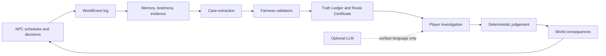

<h1 align="center">Detective Town</h1>

<p align="center"><strong>让小镇先真实生活，再从事件日志中长出一宗可证明的案件。</strong></p>

<p align="center">A deterministic world-simulation and investigation engine where cases emerge from simulated lives.</p>

<p align="center">
  <a href="https://github.com/wangyufanshuai/detective-novel-lab/actions/workflows/ci.yml"></a>
  
  
  
  <a href="./LICENSE"></a>
</p>

<p align="center">
  <a href="#快速开始">快速开始</a> ·
  <a href="#核心循环">核心循环</a> ·
  <a href="#系统架构">系统架构</a> ·
  <a href="#验证状态">验证状态</a> ·
  <a href="#文档导航">文档导航</a>
</p>


> [!IMPORTANT]
> 当前版本是 Alpha production candidate。代码、构建、规则契约、鉴权边界、响应式浏览器验收和核心回归已经有自动化证据；真人理解度、独立视觉评审以及 5000/10000 tick 的公平案件再生仍未通过。因此，本项目不会把“测试通过”写成“已经好玩”或“已经 Beta”。

## 项目是什么

Detective Town 不是一次性生成故事的聊天界面，而是一个**确定性世界模拟 + 公平推理 + 可回放审计**系统：

```text
NPC 目标、关系、记忆、资源与压力
                ↓
          WorldEvent 事件日志
                ↓
      证词、物证、记忆与时间线
                ↓
        候选案件与公平性验证
                ↓
      玩家调查、证据链与理论提交
                ↓
       本地判定与可解释的世界后果
                ↺
```

世界规则拥有真相 authority。AI 可以生成 NPC 的表层对白或可选结案文案，但不能写入凶手、证据归属、时间线、Truth Ledger 或 judgement。

### 它解决什么问题

直接让模型写一宗“看起来像推理”的故事，往往会遇到时间线漂移、证据凭空出现、无辜者无法排除和重试结果变化。Detective Town 将这些约束放到可检查的状态与规则中：

| 问题 | Detective Town 的处理方式 |
| --- | --- |
| 真相会不会随提示词改变 | 由确定性世界状态、事件和规则提取 |
| 证据从哪里来 | 证据必须能回溯到事件、记忆或作者输入 |
| 玩家是否有公平路径 | Route Certificate、证据覆盖和 deterministic judgement |
| 重试是否会重复推进世界 | action id、幂等收据与 runtime revision CAS |
| 玩家能否看到隐藏真相 | player projection 与 admin projection 分离 |
| 一宗案件结束后发生什么 | 结案进入世界后果和 campaign progression |

## 核心循环

玩家的主路径是一个世界模拟调查循环，而不是单纯的问答：

1. **观察**：查看地图、地点、人物和当前世界行动。
2. **搜索**：调查现场，从公开世界状态中发现可验证线索。
3. **询问与质证**：向人物提问，用已发现证据检查证词和时间线。
4. **建模**：在推理桌连接嫌疑人、动机、手法、时间与证据链。
5. **提交**：本地 judgement 检查证明义务；驳回时只返回最小的缺失条件。
6. **结案与后果**：接受、恢复或驳回会写入世界历史，改变后续可见语境。

案件不是互相隔离的关卡。NPC 会继续行动、记忆、结盟、隐瞒和承受压力；案件的公开后果可以成为下一章的社会条件。

## 当前产品表面

| 表面 | 用途 | 主要用户 |
| --- | --- | --- |
| 玩家小镇 | 地图探索、人物调查、证据与推理桌、结案后果 | 玩家 |
| Persistent Agent Town | 运行 NPC、事件、记忆、资源和压力 | 研究者、系统作者 |
| Authoring / Review | WorldPackage、案件、Truth Ledger、Route Certificate、回放差异 | 作者、评审 |
| Public Reader | 公开聚合数据和防剧透案件摘要 | 读者、研究者 |
| Admin Operations | 鉴权审计、幂等收据和 SQLite 健康状态，只读 | 运维人员 |

工具、作者和实验入口与玩家主流程分离。玩家响应只读取安全投影；完整内部账本属于受保护的 author/admin 表面。

## 快速开始

### 环境要求

- Node.js 22、23 或 24
- npm 10 或 11
- Windows、macOS 或 Linux

### 安装与运行

```powershell
git clone https://github.com/wangyufanshuai/detective-novel-lab.git
cd detective-novel-lab
npm ci
npm run dev -- -p 3000
```

打开：

- [Server Runtime](http://127.0.0.1:3000/?runtime=server)：完整世界模拟、SQLite 存档和玩家调查。
- [Static Runtime](http://127.0.0.1:3000/?runtime=static)：只读演示，不调用 `/api/*`，不写数据库。
- [首案研究入口](http://127.0.0.1:3000/?runtime=server&study=1)：用于独立理解度研究，不把作者自测当作研究结果。

首次体验建议从 [首案指南](./docs/first-case-guide.md) 开始，依次完成 Observe → Search → Question → Challenge → Evidence → Theory → Source Review。

### 环境变量

复制 `.env.example` 为 `.env.local`，按需配置：

```dotenv
AI_PROVIDER=mock
DATABASE_URL=file:./data/mystery-town.db
NEXT_PUBLIC_DEMO_MODE=server

# 可选：仅给受保护的 admin 运维表面使用
RUNTIME_ADMIN_TOKENS=
RUNTIME_ADMIN_SESSION_TOKEN=
```

本地开发建议使用 `AI_PROVIDER=mock`，这样不需要外部模型密钥也能运行确定性核心。DeepSeek 或 SiliconFlow 只参与表层语言，不能改变案件 authority。生产样配置在启用 admin 表面时必须提供 token 或可信代理 session secret：

```powershell
npm run quality:production-config
```

## 系统架构



核心目录：

```text
packages/engine/src/       世界模拟、案件提取、规则验证、判定与 campaign
lib/engine/                 应用层稳定 re-export
lib/world/                  SQLite repository、运行时持久化和安全投影
app/                        Next.js 玩家、作者、评审和研究界面
app/api/v1/                 Agent Control、player/admin command 与 query
world-packs/                版本化世界包：地图、规则、生态和场景
public/noir-archive/        地图、人物、物证和授权清单
scripts/                    测试、回放、数据集、浏览器和发布门禁
docs/                       架构、schema、运行手册和验证报告
```

关键边界：

- `player projection` 只返回玩家完成当前行动所需的信息。
- `admin projection` 供作者、实验和运维使用，必须经过鉴权。
- Truth Ledger、证据成员、judgement 与存档协议不由表现层决定。
- `/api/v1` 保持向后兼容；新增字段使用兼容式扩展。

详见 [架构说明](./docs/architecture.md)、[世界模型](./docs/world-model.md)、[运行时边界](./docs/runtime-surface-boundary.md) 和 [AI 安全边界](./docs/ai-safety.md)。

## 验证状态

以下是当前仓库已有的可复核工程证据；它们不替代真人体验评价：

| 验证 | 当前状态 | 说明 |
| --- | --- | --- |
| TypeScript | `pass` | `npx tsc --noEmit` |
| Production build | `pass` | `npm run build` |
| Public projection | `pass` | `npm run test:world-projection` |
| Admin authentication | `pass` | `npm run test:admin-auth`，含未配置 fail-closed |
| Runtime idempotency | `pass` | `npm run test:town-runtime-idempotency` |
| Storage | `pass` | `npm run test:storage` |
| Goal 19 browser candidate | `automated-pass` | 390×844、1280×720；玩家、admin、低感官、焦点与未授权状态 |
| Five-size visual matrix | `automated-pass` | 390、768、1280、1440、1920 |
| 5000 / 10000 tick fairness regeneration | `failed` | 长跑性能与公平案件再生仍需修复 |
| 真人理解度 | `human-pending` | 需要非作者参与者，不能用自动化替代 |
| 独立视觉评审 | `human-pending` | 需要外部 reviewer 对层级、动效和窄屏体验签署 |
| Beta / public deployment | `held` | 在上述人工门禁和长跑问题解决前不宣称 Beta |

### 常用验证命令

```powershell
# 基础构建与核心回归
npx tsc --noEmit
npm run build
npm run test:world-projection
npm run test:town-runtime-idempotency
npm run test:storage

# 鉴权与 production-candidate 浏览器验收
npm run test:admin-auth
npm run qa:goal19-production -- --output=outputs/detective-world-simulation-goal19-20260912

# 五尺寸玩家视觉回归
npm run qa:goal10-visual -- --json --output=outputs/detective-world-simulation-goal19-20260912
```

验证结果与限制见本地 `outputs/detective-world-simulation-goal19-20260912/goal19-production-candidate-report.md`（`outputs/` 默认被 `.gitignore` 忽略），以及仓库内的 [v11.1 Gold Slice evidence index](./docs/v11.1-gold-slice-evidence-index.md)。

## 作者、研究者和 Agent

### 创建或扩展 WorldPackage

一个可接受的 WorldPackage 至少需要地图、规则目录、生态目录、场景包、agent pack、manifest 和 README。先阅读 [WorldPackage 编写与兼容](./docs/world-package-authoring-and-compatibility.md)，再运行：

```powershell
npm run package:validate
npm run validate:campaign-contribution -- --json
npm run test:v11-world-packages
```

不要在公开投影中放入 culprit、secret、source map、原始 memory 或未发现证据字段。

### Agent 与实验集成

- [Agent Control API](./docs/agent-control-api.md)：稳定 `/api/v1` command/query 边界。
- [SDK API](./docs/sdk-api.md)：Node 集成入口。
- [Persistent Agent Town](./docs/persistent-agent-town.md)：事件、记忆、资源和压力模型。
- [Scenario Pack Review Bundle](./docs/scenario-pack-review-bundle.md)：基线、反事实、快照、回放和差异。

### 研究与真人验收

自动求解只能证明一条认证路径存在，不能证明人类能理解。理解度研究请使用 [研究协议](./docs/first-case-comprehension-protocol.md) 和 [审阅模板](./docs/templates/campaign-comprehension-review.md)；视觉评审请使用 [art direction 模板](./docs/templates/art-direction-approval.md)。

## 文档导航

- [首案指南](./docs/first-case-guide.md)：第一次完整调查。
- [架构](./docs/architecture.md)：引擎、运行时与 UI 边界。
- [案件 Schema](./docs/case-schema.md)：作者输入与校验合同。
- [运行模式](./docs/runtime-modes.md)：Static 与 Server 的差异。
- [Authoring Workbench](./docs/authoring-workbench.md)：作者与评审工作台。
- [World Simulation Depth](./docs/world-simulation-depth.md)：世界模拟的长期设计。
- [Release Checklist](./docs/release-checklist.md)：发布前完整门禁。
- [CHANGELOG](./CHANGELOG.md)：版本变化。

## 贡献方向

目前最有价值的贡献不是再添加一个孤立系统，而是解除真实门禁：

1. 修复 5000/10000 tick 后公平案件再生枯竭的问题，并保留现有确定性和证据约束。
2. 按协议完成非作者首案理解度测试，记录用户卡点和误解路径。
3. 为剩余路线补充有许可、来源、尺寸和对象映射的视觉/音频资产。
4. 提交新的 WorldPackage 时同时提供 manifest、验证结果、双路线差异和可重放 playthrough。
5. 任何影响 Truth Ledger、public projection 或 `/api/v1` 的改动，都应附带对应契约测试和兼容说明。

## 许可证

MIT License，详见 [LICENSE](./LICENSE)。素材许可与来源见 `public/noir-archive/ASSET-LICENSES.md`、`public/noir-archive/DISTRICT-ART-LICENSES.md` 和 `public/fonts/noir/sources.json`。
