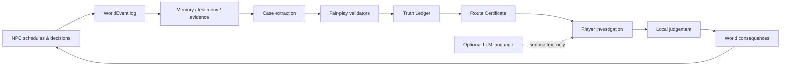

<h1 align="center">DETECTIVE TOWN</h1>

<p align="center"><strong>不是让 AI 临时编一个凶手，而是先让小镇真实生活，再从事件日志中长出一宗可证明的案件。</strong></p>

<p align="center">
  A fair-play mystery engine where cases emerge from simulated NPC lives.
</p>

<p align="center">
  <a href="https://github.com/wangyufanshuai/detective-novel-lab/actions/workflows/ci.yml"></a>
  
  
  
  
  <a href="./LICENSE"></a>
</p>

<p align="center">
  <a href="#-3-分钟开始调查">快速开始</a>
  ·
  <a href="./docs/first-case-guide.md">首案指南</a>
  ·
  <a href="./docs/architecture.md">架构</a>
  ·
  <a href="./docs/v11.1-gold-slice-evidence-index.md">验证证据</a>
</p>


> [!IMPORTANT]
> 当前是自动化验证充分、但尚未晋级 Beta 的 Alpha：RC 自动化、72 案路线和浏览器矩阵已经闭合；5000/10000 tick 长跑的公平案件再生仍失败，真人理解度与独立艺术评审仍待完成。项目不会把“测试很多”写成“已经证明好玩”。

## 为什么不是再做一个 AI 小说生成器

让大模型直接写推理故事很快，但它很难稳定保证时间线闭合、线索充分、无辜者可排除、玩家没有读心才能破案。Detective Town 把这些问题交给可检查的世界状态与规则引擎：

```text
NPC 日程、关系、秘密、压力和资源
                ↓
          WorldEvent 日志
                ↓
    记忆、证词、物证与事件链
                ↓
  候选案件 → 公平性验证 → Route Certificate
                ↓
         玩家调查与 Theory Judgement
```

DeepSeek 只可用于 NPC 表层对白和可选结案文案。凶手、手段、证据归属、时间线和判定结果由本地 TypeScript 规则决定。

| 维度 | 直接生成故事 | Detective Town |
|---|---|---|
| 真相 | 一次提示词中的文本结论 | 从不可变事件与世界状态提取 |
| 证据 | 模型“记得”写过什么 | Truth Ledger 与证据覆盖率 |
| 可破案性 | 主要靠人工通读判断 | Route Certificate + deterministic auto-solve |
| NPC | 为当前段落服务 | 跨 tick 保留目标、记忆、关系和压力 |
| 重放 | 模型或采样变化会漂移 | 固定 seed、规则、快照与 replay 制品 |
| AI 权限 | 可能同时写真相和裁决 | 只负责表层语言，不拥有案件 authority |

## 30 秒看懂玩法

1. **观察小镇**：在地图上选择地点、人物与当前高显著事件。
2. **加入案件**：从现场搜索、证人提问和证词质证中取得可验证信息。
3. **构建推断**：把证据加入或排除，连接主张、矛盾、时间和因果关系。
4. **提交理论**：本地引擎检查证明义务，错误理论只暴露最小安全缺口。
5. **影响世界**：结案进入小镇后果账本，改变后续制度压力、人物行动和案件语境。

案件不是互不相干的关卡。世界继续运行，NPC 继续记忆、计划、隐瞒、结盟或犯错；一宗案件的公开后果可能成为下一宗案件的社会条件。

## 三种使用方式

### 玩家：三章式推理战役

- 12 个 Campaign、每个 2 条 authored route、共 72 个 treatment。
- 每条路线固定三宗案件，并以不同的地点、机构压力、调查节奏和 Finale 收束。
- 地图、Current Objective、Current Action、调查工作台和后果账本共享同一认证动作适配器。
- 静态展示与 Server Runtime 共用公平推理边界，但静态模式不调用 `/api/*`。

### 作者与评审：案件生产工作台

- 内置案例、WorldPackage、Case Gallery 与 JSON 导入/导出。
- Truth Ledger 显示证明义务、玩家覆盖和缺口；Route Certificate 证明完整调查路径存在。
- Public Dataset Explorer 只公开聚合分布和防剧透案件卡，不泄漏原始案情或 culprit 字段。
- Replay Bundle、Time Machine Diff、baseline/counterfactual 报告与受保护 public tree 审计。

### 研究者与 Agent：活世界实验

- Persistent Agent Town 用 SQLite 保存 NPC 目标、计划、记忆、资源、压力和跨 tick 行动评分。
- Scenario Runner 支持基线/反事实分支、快照、回滚、差异和可重复 benchmark。
- Living World Lab 可从小说章节抽取世界图，做来源定位、人工修正覆盖和 grounded replay。
- 稳定 `/api/v1/*` Agent Control API 与零依赖 Node 示例，外部 Agent 仍不能绕过本地规则 authority。

## ⚡ 3 分钟开始调查

需要 Node.js 22–24 与 npm 10–11：

```powershell
git clone https://github.com/wangyufanshuai/detective-novel-lab.git
cd detective-novel-lab
npm ci
npm run dev -- -p 3000
```

选择入口：

- 静态展示：<http://127.0.0.1:3000/?runtime=static>
- 本地世界：<http://127.0.0.1:3000/?runtime=server>
- 真人理解度研究：<http://127.0.0.1:3000/?runtime=server&study=1>

Static Runtime 用于公开演示，不写 SQLite、不调用模型、也不请求 `/api/*`。Server Runtime 才启用持久小镇、Scenario Runner、Agent API 和可选 DeepSeek 表层语言。

首轮推荐按照 [First Case Guide](./docs/first-case-guide.md) 完成 Observe → Search → Question → Challenge → Evidence → Theory → Source Review。

## 系统边界



主要代码边界：

```text
packages/engine/src/          世界模拟、案件提取、验证、判定、地图和推理图
lib/engine/                   面向应用的稳定 re-export
app/                          Next.js 玩家、作者、评审和研究工作台
app/api/v1/                   稳定 Agent Control API
lib/world/repository.ts       Server Runtime 的 SQLite 持久化
world-packs/                  版本化世界包
examples/                     SDK、Agent、Scenario Runner 与纠错示例
scripts/                      规则、回放、数据集、发布与浏览器门禁
```

更完整说明见 [Architecture](./docs/architecture.md)、[World Model](./docs/world-model.md) 与 [AI Safety](./docs/ai-safety.md)。

## 公平推理不变量

- **真相不可由表现层修改**：地图、动画、剧情节奏与文案只读取 public-safe 投影。
- **证据必须有来源**：案件证据能追溯到世界事件、记忆或明确作者输入。
- **无辜者必须可排除**：正确解不只命中凶手，还要满足时间、手段、动机和反例约束。
- **错误理论最小泄漏**：恢复提示只指出下一类证明缺口，不泄漏完整路线。
- **自动求解不是玩法评价**：它只证明认证操作路径可达，不能证明谜题有趣或人类能理解。
- **AI 不拥有裁决权**：自由文本输出无法直接写入 Truth Ledger、证据成员或 judgement。

## 当前验证状态

| 门禁 | 状态 | 它证明什么 |
|---|---|---|
| RC aggregate | `63 / 63 automated-pass` | 类型、构建、核心、内容、API、浏览器、隐私和 protected-public 回归闭合 |
| Campaign route | `72 / 72 automated-pass` | 12 Campaign × 2 route × 3 case 可重复完成 |
| 24-seed fairness | `automated-pass` | 当前发行矩阵在冻结种子上的公平性约束 |
| Gold Slice | `automated-pass` | Midnight Chorus 六案的表现与 authority boundary |
| 5000 / 10000 tick | `failed` | 长跑性能可完成，但公平案件再生不足，保留真实失败 |
| 真人理解度 | `human-pending` | 仍需 5 名非作者参与者，至少 4/5 达标 |
| 独立艺术评审 | `human-pending` | 视觉层尚未获得独立 reviewer 签署 |
| Beta / deploy | `held` | 上述人工与长跑门禁未解除前不晋级 |

证据索引、适用范围和未宣称事项见 [v11.1 Gold Slice Evidence Index](./docs/v11.1-gold-slice-evidence-index.md)。动态哈希与耗时以生成的本地 evidence manifest 为准，README 不维护第二份副本。

### 常用验证命令

```powershell
npm.cmd run test:seventy-two-case-campaign -- --json
npm.cmd run quality:rc -- --json
npm.cmd run qa:v11-alpha-browser -- --json
npm.cmd run report:v11-alpha -- --json
```

完整 v10 干净环境复核会从显式快照重新安装依赖并运行两轮 RC，成本更高：

```powershell
npm.cmd run quality:v10-clean-worktree -- --snapshot=HEAD
```

## 文档地图

- [首案指南](./docs/first-case-guide.md) — 玩家第一次完整破案。
- [架构](./docs/architecture.md) — 引擎、运行时与 UI 边界。
- [案件 Schema](./docs/case-schema.md) — 作者输入和校验合同。
- [WorldPackage 编写与兼容](./docs/world-package-authoring-and-compatibility.md) — 新世界包准入。
- [Scenario Pack Review Bundle](./docs/scenario-pack-review-bundle.md) — 实验与评审制品。
- [SDK API](./docs/sdk-api.md) / [Agent Control API](./docs/agent-control-api.md) — 外部集成。
- [v11.0 Alpha Baseline](./docs/v11.0-alpha-baseline.md) — 冻结矩阵与验证入口。
- [v11.1 Gold Slice](./docs/v11.1-cinematic-deduction-gold-slice.md) — 当前体验黄金切片。
- [CHANGELOG](./CHANGELOG.md) — 版本变化。

## 现在最值得贡献什么

当前不缺更多系统名词，最缺的是能解除真实门禁的贡献：

1. 按模板完成非作者首案理解度测试，记录卡住的位置而不是只打“好玩/不好玩”。
2. 修复长跑中 `missing real case trigger` 与 `missing means` 的再生问题，同时保持当前短战役公平性。
3. 为剩余 Campaign 补充有明确许可、哈希和中英安全投影的视觉/音频资产。
4. 提交新的 WorldPackage 时同时提供三章 Route Certificate、双路线差异和可复现 playthrough。

MIT License，详见 [LICENSE](./LICENSE)。
