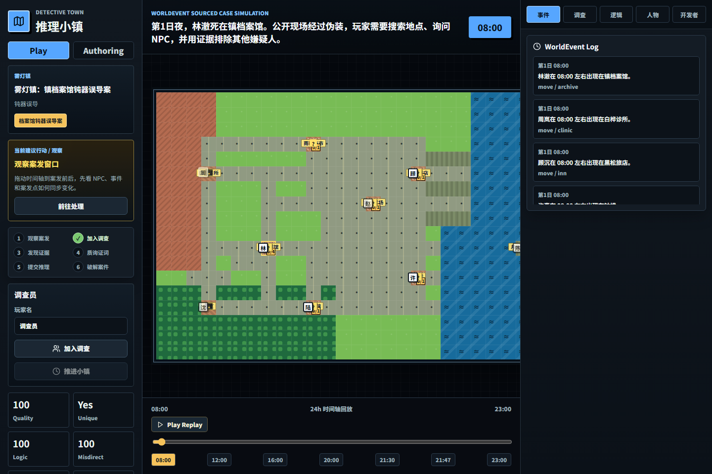

# Detective Town

**A murder mystery engine where cases emerge from simulated NPC lives.**

Detective Town is a local-first mystery engine for fair-play detective games. It does not ask an LLM to invent the culprit or write a mystery from scratch. The engine first simulates a town: NPC schedules, relationships, secrets, memories, conflicts, movements, evidence, and testimony. A case is then extracted from the world event log and validated by local TypeScript rules.

The project now also includes two advanced labs:

- **Persistent Agent Town**: a SQLite-backed runtime where NPCs keep goals, plans, memories, pressure, resources, and action scores across ticks until playable case candidates emerge.
- **Living World Lab + Audit Studio**: a novel/world observer workbench for extracting a world graph from chapters, auditing extraction quality, applying local correction overlays, replaying source-backed character actions, and exposing the same observe -> decide -> intervene -> observe loop through `/api/v1/*`.
- **Scenario Runner + Time Machine**: reproducible town experiments with baseline/counterfactual branch reports, tick snapshots, state diffs, rollback, and benchmark visibility.
- **Local Case Gallery**: a browser-only Authoring library for built-in Premium templates, locally saved drafts, JSON bundle import/export, and valid-draft launch into Static Demo Runtime.

DeepSeek is used only for NPC surface dialogue and optional solution prose. It does not decide the culprit, method, evidence, or timeline.



**Online demo:** public deployment URL is not connected yet. Deploy the repository to Vercel and open `https://<project>.vercel.app/?runtime=static` for the browser-only Static Demo Runtime. It needs no API key, no SQLite write access, and no `/api/*` calls. See [docs/static-demo-vercel.md](docs/static-demo-vercel.md).

## Release Status

- Latest planned release: `v0.1.0`.
- CI covers engine tests, build, emergence benchmark, Scenario API smoke, SDK smoke, and browser E2E.
- Docker Smoke covers Server Runtime startup and static page loading.
- Static Demo is public-demo ready alongside the v6.2 Server Campaign instrumentation baseline: Playable Investigation Path -> one Server-only Case & World Consequence summary -> Guided Manual Run -> Guided Step Journal -> Static Playthrough Proof -> Source Review Unlock -> Solved Case Debrief -> Replay Practice Loop -> Replay Goal Coach -> Manual Evidence Drill -> Manual Theory Drill -> Replay Attempt Scorecard -> Reviewer Home -> Pack / Replay / Map / Agent -> Proof Strip -> Stable World Proof -> Case Quality Proof -> World-System Influence Proof -> Dataset Reader -> Public Case Explorer -> Audit Boundary, all without `/api/*`.
- Core simulation now has a v5.6 public-safe Case Quality Proof: the three-seed 1000 tick gate still proves stability, and a non-blocking aggregate score now summarizes fair-play evidence, provenance, diversity, continuity, institution relevance, repeat control, and solution readiness.
- Detective content now has a v6.2 public-safe world-system and playable path: v6.1 world consequences remain unchanged, while an optional Server-only `?study=1` recorder measures human campaign comprehension using browser-local aggregate summaries. Instrumentation is ready; the required eight official human sessions have not yet passed the human gate.
- Project-level v3.6/v3.7 assessment and roadmap: [docs/project-level-report.md](docs/project-level-report.md).

## Try In 3 Modes

```powershell
npm install
npm run dev -- -p 3000
```

- **Static Demo**: open `http://127.0.0.1:3000/?runtime=static` for the public, no-server Premium Showcase plus the Playable Investigation Path, Guided Manual Run, Guided Step Journal, Static Playthrough Proof, Source Review Unlock, Solved Case Debrief, Replay Practice Loop, Replay Goal Coach, Manual Evidence Drill, Manual Theory Drill, Replay Attempt Scorecard, Static Reviewer Home, Pack / Replay / Map / Agent main path, Proof Strip, Stable World Proof drilldown, non-blocking Case Quality Proof, World Systems overview, aggregate Public Dataset Explorer, and spoiler-safe Public Case Explorer.
- **Server Runtime**: open `http://127.0.0.1:3000/?runtime=server` for SQLite-backed worlds, Persistent Agent Town, the optional World Lead Loop after Join, the Town Social Response cycle after real player-driven world results, Server Playthrough Proof for emerged cases, Scenario Runner, Time Machine, and optional DeepSeek dialogue.
- **Campaign Study**: open `http://127.0.0.1:3000/?runtime=server&study=1` to show the default-collapsed browser-local recorder. Follow [the moderator protocol](docs/campaign-comprehension-study.md) and review the [aggregate gate status](docs/campaign-comprehension-results.md). Static Runtime never initializes this recorder, even when `study=1` is present.
- **Agent API**: run `node examples/agent-client-node/index.mjs` or `node examples/scenario-runner/index.mjs` against a running server, or reuse the SDK starter in `examples/sdk`.

In Static Demo, open **Authoring** and use **Save to Gallery** for a browser-local case library. Gallery data lives in `localStorage`, can be exported as JSON, and does not require server APIs.

## 5-Minute Technical Review Path

Use this path when evaluating the Persistent Agent Town runtime instead of the player-facing mystery route:

1. Start Server Runtime and open `http://127.0.0.1:3000/?runtime=server`.
2. Open **持续小镇** from the main workbench.
3. In **Review Mode: 5-minute evaluator path**, inspect **Current Experiment** and choose a built-in **ScenarioPack** or a synced **World Package**.
4. Use **New Run from Pack** to create an isolated branch world and queue a scenario RunJob from the selected ScenarioPack, MapPack, RuleCatalog, and optional Agent/Ecosystem package.
5. Select the new row in **Scenario Run History** or **Run Catalog**.
6. Use **Time Machine Diff** controls to compare baseline or branch snapshots.
7. Export **Review Bundle** as JSON/Markdown or **Replay Bundle** as JSON. The bundles include the scenario report, selected snapshots, selected diff, branch comparison, run catalog data, pack metadata, and optionally the latest benchmark report.
8. Audit local replay artifacts after runs:

```powershell
npm run replay:audit
npm run replay:sync
npm run package:sync
npm run package:export -- --package=city-hall-merchant-debt-town
npm run benchmark:catalog-expansion
npm run benchmark:ecosystem-ablation
npm run benchmark:stable-world
npm run benchmark:campaign -- --ticks=1000
npm run benchmark:campaign -- --ticks=5000
npm run benchmark:experiment-matrix
npm run dataset:export -- --run=campaign-campaign-validation-5000
npm run dataset:validate -- --path=outputs/dataset-packages/detective-town-v3-5000-campaign
npm run dataset:smoke -- --path=outputs/dataset-packages/detective-town-v3-5000-campaign
npm run dataset:reader -- --path=outputs/dataset-packages/detective-town-v3-5000-campaign
npm run dataset:static-reader -- --path=outputs/dataset-packages/detective-town-v3-5000-campaign
npm run qa:static-reader
npm run content:validate
npm run public-catalog:build
npm run public-catalog:validate
npm run qa:release-local
npm run replay:audit -- --json
```

Run history, snapshots, diffs, replay bundles, map packs, current experiment selection, package selection, benchmark summaries, and job records are stored in runtime JSON plus local artifacts in `data/replay-store/<runId>/` in this release. Scenario and Quick 10 / Full 20 benchmark work use cooperative RunJobs: `start` queues work, `tick` advances one time slice, and the UI polls progress/cancel state. `npm run replay:sync` mirrors the generated replay dataset index into the local SQLite catalog for filtering and Review Mode inspection; the replay-store files remain the artifact authority.
`npm run replay:audit` builds `data/replay-store/index.json` from scenario, benchmark, campaign, simulation-quality, and experiment-matrix artifacts. The index stores relative artifact paths, bytes, sha256 hashes, normalized run metadata, inferred metrics, and audit findings. It must not contain API keys, absolute local paths, runtime point-in-time state dumps, or hidden-answer fields.
`npm run package:sync` discovers `experiments/` and `world-packs/`, validates package integrity and safety, writes `data/package-catalog/index.json`, and mirrors package metadata into SQLite. The generated indexes and SQLite catalog rows are local data under the ignored `data/` directory; they are not committed by default.
`npm run package:export -- --package=<id>` writes a local folder export under `outputs/world-package-exports/<id>/`. The export contains package source files plus hash and validation metadata only; it excludes replay artifacts, SQLite data, runtime point-in-time state dumps, agent snapshots, hidden-answer fields, absolute paths, and secret-looking content.
`npm run dataset:export -- --run=campaign-campaign-validation-5000` writes a local dataset package under `outputs/dataset-packages/detective-town-v3-5000-campaign/`. It snapshots replay/package indexes, copies sanitized 5000 tick run metadata and local world package sources, and writes checksums plus a dataset card for offline review.
`npm run dataset:reader -- --path=outputs/dataset-packages/detective-town-v3-5000-campaign` reads the exported package offline through `reader-index.json`, without using SQLite, the dev server, or the original replay-store directory.
`npm run dataset:static-reader -- --path=outputs/dataset-packages/detective-town-v3-5000-campaign` writes a tracked public static reader snapshot under `public/dataset-reader/detective-town-v3-5000-campaign/` for `?runtime=static`. It contains aggregate reader metadata, a public-safe card, manifest metadata, and `case-summary-index.json` spoiler-safe case cards; it does not include full replay artifacts or package source bodies.
`npm run qa:static-reader` runs the repeatable public-reader file QA: validate the full dataset package, refresh the static reader bundle, read the static bundle, and block forbidden fields or absolute paths under `public/dataset-reader`.
`npm run content:validate` validates the detective content tables under `content/detective-v1/` and prints an aggregate public-safe summary. v5.27 extends the existing Server Runtime **Shared World Lead Outcome Cycle** with a one-time **Case Aftermath Handoff**: after an accepted player theory settles a followed outcome, the next candidate queue receives only a fixed `+2` preference for the matching low-spoiler case type. The first successful next extraction consumes it whether or not the player chose the preferred candidate. It adds no endpoint, SQLite schema, public artifact, dataset refresh, long gate, hidden truth, or raw-id UI; truth, candidate membership, route coverage, and legal NPC actions remain unchanged. Static Runtime shows only the safe server-loop boundary and remains zero `/api/*`. `npm run qa:release-local` verifies the public boundary, static browser path, Server Runtime flow, public-artifact stability, build, and replay audit.
v3.2 keeps these catalog/export commands as Node-only local adapters with explicit workspace subtrees; generated indexes, SQLite rows, package exports, and dataset packages remain rebuildable local artifacts rather than source-controlled authority.
v5.15 adds Server Playthrough Proof to the local gate: `npm run qa:release-local` verifies an emerged Persistent Agent Town case, runs the explicit server certified playthrough, and checks aggregate accepted-theory metrics without changing public artifacts or the 5000 tick dataset.
v5.16 adds Unified Source Review Unlock: after Static or Server certified playthrough reaches accepted theory, the Investigation panel opens a solved-case source review workbench for Source Trail, Proof Obligations, Certified Route, and Conclusion Review using existing local data only.

v5.17 adds Guided Manual Investigation Run: the Investigation panel can now advance one low-spoiler player step at a time through Join, Search, Question, Challenge, Select Evidence, Submit, and Review Source. Static stays browser-local with no `/api/*`; Server Runtime reuses existing local investigation APIs and does not add public schema, public artifacts, SQLite schema, dataset refreshes, or long gates.

v5.18 adds Guided Step Journal: each guided run records session-only low-spoiler step entries for Join, Search, Question, Challenge, Select Evidence, Submit, and Review Source, including progress deltas, next action, certified fallback use, and source review unlock without writing repo JSON, SQLite schema, public catalog files, or dataset snapshots.

v5.19 adds Solved Case Debrief: after an accepted Static or Server investigation, the UI summarizes the player route, evidence closure, source confidence, and next replay goal using only local aggregate state from the session, journal, proof coverage, and source review unlock. It does not add public schema, public artifacts, API endpoints, SQLite schema changes, dataset refreshes, or long gates.

v5.20 adds Replay Goal Coach: after Debrief, a player can start a session-local replay attempt focused on reducing certified fallback, selecting evidence manually, using fewer guided clicks, and reviewing source after submit. Static stays browser-local with zero `/api/*`; Server Runtime reuses the existing local join flow.

v5.21 adds Replay Attempt Scorecard: after a replay attempt starts, the UI shows pending and completed descriptive deltas for guided clicks, certified fallback, selected evidence, proof gaps, source review unlock, and completed replay goals. It is session-local UI explainability, not a score, gate, public catalog authority, dataset refresh, runtime scoring change, or long-run benchmark.

v5.22 adds Manual Evidence Drill: during an active replay attempt, discovered proof clues appear as low-spoiler evidence cards with Add to Theory / Remove from Theory controls before submit. The drill updates the session journal and scorecard manual-pick signal while certified fallback remains explicit; it adds no public schema, artifact, endpoint, dataset refresh, SQLite schema change, runtime scoring change, or long gate.

v5.23 adds Manual Theory Drill: after manual evidence picks are ready, replay submit becomes Manual First for suspect, motive, and method. The drill uses only discovered evidence labels and visible descriptions for free-text prompting, records field-level manual/fallback attribution in the Journal and Scorecard, and keeps certified fallback explicit without copying hidden answers into visible inputs.

v5.24 adds Replay Practice Loop: a session-local status header above Replay Goal Coach shows Start, Discover, Pick Evidence, Fill Theory, Submit, Review Source, and Scorecard phases plus manual/fallback aggregate counts and the next low-spoiler action. It is information architecture polish, not a public catalog artifact, dataset refresh, long gate, runtime scoring change, or new API.

v5.25 adds World Lead Loop: after Join in Server Runtime, one deterministic safe lead derived from existing world-system hints can be followed or skipped. Follow persists a per-session decision in existing runtime JSON and prioritizes only the next eligible certified Search, Question, or Challenge; Skip and Static Runtime preserve the original route. The loop never exposes raw ids or hidden truth and does not change candidate legality, proof coverage, public artifacts, SQLite schema, or long-run gates.

v5.26 adds Shared World Lead Outcome Cycle: resolving a followed lead applies exactly one low-spoiler, reversible benefit/tradeoff for the current case. Search, Question, and Challenge use fixed bounded mappings across the existing location profile, mapped institution, and resource ledger. The outcome is shared across sessions, never changes the certified route or NPC legality, and settles after accepted theory or before another case opens. Static Runtime remains explanatory only and zero `/api/*`.

v5.27 adds Case Aftermath Handoff: only an accepted player theory that settles a followed outcome prepares one Server Runtime-only next-case preference. Search, Question, and Challenge map to evidence-tampering, false-testimony, and court-intimidation respectively; the final candidate sort applies a fixed `+2` bonus without changing candidate membership, legality, truth, coverage, or the certified route. Any first successful next extraction consumes the preference, including a player-selected non-preferred candidate. The stored runtime record keeps raw case keys internal while UI and responses expose only ready/consumed safe summaries; Static remains explanatory and zero `/api/*`.

v5.28 adds Case-Scoped World Arc: after route-integrity succeeds, Server Runtime rebinds resource, faction, event, progression, and action hints to the case type that was actually extracted. Each progression line keeps a resumable stage counter in existing Persistent Town JSON. Only a followed lead that reaches its certified step and ends in an accepted player theory advances one stage; wrong theories, Skip, autosolve, preview, failed extraction, and case-switch safety settlement do not. An advanced incomplete line adds only a fixed `+1` to its stable top NPC action and compatible final candidate ranking, while v5.27 handoff remains an independent `+2`. Location, institution, and resource effects still settle reversibly; no truth, candidate set, legal action set, route certificate, evidence coverage, endpoint, SQLite schema, public artifact, or Static API boundary changes.

v5.29 adds Faction Directive Runtime Cycle: each real-player accepted Follow that advances a World Arc prepares one deduplicated, FIFO Server Runtime directive. Event-archetype content supplies safe Support and Contain mappings to existing institutions, strategies, and long actions; Defer remains open, while Support or Contain is a zero-tick schedule that opens a bounded 12-tick execution window and starts only on the next legal institution cadence. Completion keeps the existing resource, institution, public-opinion, and evidence-chain results as bounded town history. A blocked operation refunds only its recorded reservation once and permits an alternate response. Future unextracted cases may respond organically, but the active or extracted case truth, evidence coverage, route certificate, legal action set, and judgement remain frozen. Static stays explanatory and zero `/api/*`; no endpoint, SQLite schema, public artifact, background queue, or long gate is added.

v5.30 adds World Pressure Cascade: completion of a Faction Directive derives a deterministic `rising` or `relief` pulse from the existing long action's clamp-aware applied evidence, public-opinion, institution, and reserved-resource result. Same-focus same-direction pulses merge to at most three layers; opposing directions coexist, while their independent final candidate-ordering contribution is clamped to `[-2,+2]`. Candidate previews and reads never consume pressure; each successful future extraction consumes exactly one oldest layer. The pulse changes only ordering and safe Situation Brief guidance—not candidate membership, validity, truth, evidence coverage, route certificate, NPC legal actions, or judgement. Internal source keys and deltas stay in existing runtime JSON and are stripped from public projection. Static remains explanatory and zero `/api/*`; no endpoint, SQLite schema, content schema, public artifact, background task, proof card, or long gate is added.

v5.31 begins Player Main Path Consolidation and Runtime Modularization: World Lead, Arc, Directive, Pressure, Outcome, and Handoff now share one **Case & World Consequence** surface with a single **Current world action** that prioritizes the next player decision. Existing detailed states and test ids remain available inside the same surface, while Static shows one Server-only current-action boundary without controls or `/api/*`. The UI implementation is extracted into `WorldCampaignPanel`, and World Pressure derivation, merging, consumption, safe projection, and ranking logic move from the persistent runtime monolith into a dedicated engine module without changing persisted JSON, endpoints, route fairness, or ranking behavior.

v5.32 adds Unified Influence Budget: the player-earned v5.27 Handoff, v5.28 World Arc, and v5.30 World Pressure contributions now enter one deterministic candidate-influence ledger before the final candidate sort. Their individual bounded weights remain auditable, while the combined signed effect is clamped to `[-3,+3]`; candidate membership, validity, truth, route certificate, evidence coverage, NPC legal actions, and judgement remain unchanged. Server UI and Situation Brief expose only safe source count, direction, strength, and the `±3` cap. Static shows a read-only Server-only boundary and makes no `/api/*` request. No endpoint, SQLite/content/public schema, public artifact, background task, dataset refresh, proof card, or long gate is added.

v5.33 adds Player Resource Commitment: after Join, a real player may reserve two existing units of Police Time, Informant Trust, or Evidence Integrity for the certified Search, Question, or Challenge lane, or continue without a reserve. Selection is a zero-tick, zero-event write to existing Persistent Town JSON. The matching successful investigation endpoint spends the reservation exactly once and applies one clamp-aware bounded world benefit: lower local resource pressure, lower witness fear, or lower evidence contamination. Wrong theory does not settle the cycle; accepted theory or successful case switch returns any unused reservation exactly once, while spent resources remain spent. Public runtime, Situation Brief, and Case & World Consequence expose only safe labels and aggregate status; internal session, case, location, and resource keys are stripped. Static remains explanatory, non-interactive, and zero `/api/*`; no endpoint, SQLite/content/public schema, public artifact, background task, proof card, or long gate is added.

v5.34 adds the Faction Relationship Ledger: completed player-selected directives, genuinely spent case resources, and accepted real-player theories update a bounded investigator-to-institution standing matrix in the existing Persistent Town JSON. Standing is internally clamped to `[-10,10]` and publicly reduced to `trusted`, `neutral`, `strained`, or `hostile`. Trusted partners lower the next matching case-resource reserve from two units to one, strained partners raise it to three, and hostile partners can withhold that option until explicit future recovery improves standing. Support and Contain create deterministic, different source/operating-faction results; source keys deduplicate repeated calls and internal history is capped at 64 entries. Autosolve, preview, wrong theory, failed extraction, and repeated calls award no standing. Relationships change only future resource terms and later offer prerequisites; they never modify current-case truth, evidence, route coverage, legal actions, or judgement. Static remains explanatory and zero `/api/*`; no endpoint, SQLite/content/public schema, public artifact, background service, or proof card is added.

v5.35 adds the World Event Offer Lifecycle: a completed real-player faction directive can enqueue one bounded, content-configured opportunity with `offered -> accepted | declined -> running -> completed | failed | expired` states. Accept and Decline are zero-tick writes; the next legal institution cadence reuses the existing actor, resource reservation, long-action, event, and refund rules. The offer is resource-aware at creation without injecting resources: it prefers the alternate faction response and deterministically falls back to the completed response only when that configured operation is currently affordable. Completed offers apply one explicit relationship recovery; blocked or expired offers remain safe and explain a recovery path. Situation Brief, Journal, and Case & World Consequence expose only labels, progress, deadline bands, and terminal guidance; internal source, actor, action, institution, resource, and tick keys remain private. Static shows only a Server-only lifecycle boundary with no controls and zero `/api/*`; no endpoint, schema, public artifact, background service, proof card, or long gate is added.

v5.36 adds Investigator Progression: real manual Search, Question, Challenge, evidence selection, and accepted-theory steps now accumulate a bounded, idempotent practice ledger in the existing Persistent Town JSON. Safe competency bands expose only practice marks, established unlock labels, and a low-spoiler next action. Established lane practice can reduce one future matching resource reservation to a minimum of one; established case-closure practice enables one retry for a failed or expired World Event Offer. Autosolve, previews, wrong theories without selected evidence, and counterfactual interventions never award progression. The ledger never changes the active or extracted case truth, route certificate, evidence coverage, legal actions, or judgement, and its internal source keys remain private. Static stays read-only and Server-only with zero `/api/*`; no endpoint, schema, public artifact, proof card, or long gate is added.

v5.37 expands the authored detective ecology from 10 to 16 case types, from 6 to 10 event archetypes, and from 6 to 8 progression lines. Six new contrast-driven clusters cover civic records, medical timing, dock commerce, media distortion, family pressure, and civic commerce while reusing the existing evidence, role, motive, resource, faction, directive, and long-action systems. Optional `authoredCluster`, `contrastKey`, and `campaignTags` metadata remain backward compatible under `detective-content-pack.v1`; validation rejects unsafe slugs, duplicate in-cluster contrast keys, orphan clusters, invalid directive mappings, and broken references. A deterministic authored-sequence helper selects three distinct case types from three distinct clusters for short-campaign planning. No endpoint, SQLite/public schema, public artifact, background service, or proof card is added.

v5.38 adds Failure and Recovery: rejected theories, blocked case resources, hostile institution terms, blocked faction operations, and failed or expired world opportunities now prepare one deduplicated, FIFO recovery action in existing Persistent Town JSON. Start/Defer is a zero-tick choice. Certified-route review and alternate-response guidance complete without changing world state; resource, trust, and opportunity recovery complete only on the next legal institution cadence, with bounded actual deltas and a one-time offer reopen. Recovery never rewrites current-case truth, required evidence, route certification, legal actions, or judgement, and public projection exposes only safe labels, aggregate progress, completed count, and next action. Static remains explanatory and zero `/api/*`; no endpoint, SQLite/content/public schema, public artifact, background service, event fabrication, or proof card is added.

v5.39 adds Arc Convergence Finale: two accepted certified cases plus two World Arc stages can qualify through a trusted/completed-opportunity Coalition route, a completed Recovery route, or a completed-operation/consumed-pressure Pressure-balance route. Every approach converges on the same `court-intimidation` finale family with different safe context. Convergence changes only one future candidate's type preference and adds a fixed `+3` ranking signal before the normal validation boundary; the player may still extract any legal alternative, which leaves the finale ready. Only successful extraction of the finale-family candidate activates it, and only an accepted theory for that bound case completes it. Culprit, evidence, route certificate, candidate validity, legal actions, and judgement remain under the existing case engine. Internal signal keys, case bindings, and ticks stay out of public projection; Static shows only a Server-only boundary and remains zero `/api/*`.

v6.0 packages these systems into one three-to-five-case Campaign Journey in existing Persistent Town JSON. A clean world moves through `opening -> case-active -> transition -> finale-ready -> finale-active -> completed`; successful extraction and real accepted theory remain the only case lifecycle authorities. The normal path targets three closed cases and bounds internal accepted-case history at five. The World Campaign surface shows one chapter label, `n/3` progress, one primary action, safe accumulated consequence labels, and a replay contrast. Completing the bound v5.39 finale unlocks a causal debrief assembled only from safe aggregates such as certified closures, convergence approach, relationship bands, completed operations/opportunities/recoveries, and carried pressure. The debrief is distinct from proof review: it explains world consequences, while the certified route still explains judgement. No endpoint, SQLite/content/public schema, public artifact, background service, synthetic event, or proof card is added.

v6.1 adds Town Social Response Cycle. Accepted Follow outcome settlement, completed player-selected Faction Directives, completed accepted World Event Offers, and Campaign Recoveries with an actual resource, relationship, or opportunity restoration each prepare one deduplicated ambient cycle in existing Persistent Town JSON. One normal positive tick reveals at most one response; a cycle contains at most three distinct living NPCs and the queue/history is capped at 24. Direction reuses the World Pressure applied-delta priority, while target place, affected institution staff, current occupants, related residents, and fallback actors are selected deterministically. World Campaign displays safe name, public role, public place, and low-spoiler reaction text; Situation Brief shows only the latest reaction. The ambient partition never writes `WorldEvent`, memory, observation, rule state, location authority, evidence chain, candidate cache, action score, or decision trace, so current and future candidate membership/order/validity, truth, evidence coverage, route certificate, legal actions, and judgement remain identical. Static shows one Server-only boundary with no state, controls, or `/api/*`; no endpoint, SQLite/content/public schema, public artifact, background service, or proof card is added.

v6.2 adds the Human Campaign Comprehension Gate instrumentation. Only local Server Runtime with `?study=1` renders a separate, default-collapsed Campaign Study Recorder. Its hook observes existing safe Campaign state and receives success signals from existing action handlers without changing API payloads, runtime, ticks, candidates, investigation state, or judgement. It stores at most 16 anonymous, timestamp-free aggregate runs under `detective-town-campaign-study-v1` and exports the same safe summaries as `detective-town-campaign-study-v1.json`; no identifiers, seed, selected choices, player prose, event log, raw body, or hidden truth are retained. Completed and abandoned official attempts share the fixed eight-attempt denominator, while technical interruptions require replacement. A deterministic aggregate analyzer enforces the 2 x 2 matrix, six exit thresholds, fixed confusion tie order, and report privacy without committing the per-run export. Static with `study=1` shows only a Server-only boundary and performs no study storage write or `/api/*` request. Automated instrumentation and privacy checks are ready, but v6.2 remains `instrumentation ready` until real participants complete the official matrix.

v6.2.1 adds a Study Operations Guard before recruitment. The Recorder derives exactly one read-only next slot from the existing safe run summaries: P1 and P2 must complete in order, then O1–O8 follow the fixed official sequence. Pilot abandon/interruption repeats the slot; official abandonment consumes it; official interruption requires a same-cohort replacement. The hook revalidates the slot before localStorage mutation, and the analyzer rejects correct totals in the wrong order. No study field, API request, runtime state, public artifact, or Campaign surface changes.

## Trusted Baseline Commands

Use this sequence before treating a branch as a reproducible simulation baseline:

```powershell
npm run test:replay-audit
npm run replay:audit
npm run replay:sync
npm run package:validate
npm run package:sync
npm run package:export -- --package=dock-court-market-town
npm run package:export -- --package=hospital-family-press-town
npm run package:export -- --package=city-hall-merchant-debt-town
npm run build
npm run test:persistent-town
npm run test:long-run
npm run test:simulation-quality
npm run benchmark:catalog-expansion
npm run benchmark:ecosystem-ablation
npm run benchmark:stable-world
npm run benchmark:campaign -- --ticks=1000
npm run benchmark:campaign -- --ticks=5000
npm run benchmark:experiment-matrix
npm run dataset:export -- --run=campaign-campaign-validation-5000
npm run dataset:validate -- --path=outputs/dataset-packages/detective-town-v3-5000-campaign
npm run dataset:smoke -- --path=outputs/dataset-packages/detective-town-v3-5000-campaign
npm run dataset:reader -- --path=outputs/dataset-packages/detective-town-v3-5000-campaign
npm run dataset:static-reader -- --path=outputs/dataset-packages/detective-town-v3-5000-campaign
npm run qa:static-reader
npm run content:validate
npm run public-catalog:build
npm run public-catalog:validate
npm run qa:static-browser
npm run qa:release-local
npm run replay:audit
```

The 1000 tick campaign is the v5.0 single-seed Stable Detective World gate. `benchmark:stable-world` is the v5.1 multi-seed gate, the v5.2 diagnostics surface, the v5.3 local regression dashboard, the v5.4 public-safe reviewer summary source, the v5.5 static drilldown data source, and the v5.6 non-blocking case-quality source: `campaign-validation`, `stable-town-a`, and `stable-town-b` must each produce at least 8 unique cases, at least 4 case types, repeat rate <= 20%, later-case influence >= 60%, evidence graph warnings == 0, selected action kinds >= 6, largest selected action share <= 55%, institution decisions >= 4, deterministic hash stability, and runtime under 90000 ms; the same run also writes local diagnostics, regression, and case-quality reports under `data/replay-store/<stable-world-runId>/`. The 5000 tick campaign is the v3.0 long-run gate: at least 30 unique cases, at least 10 case types, candidate repeat rate <= 15%, later-case influence >= 70%, evidence graph warnings == 0, and runtime under 300000 ms. The v3.1 dataset package is the local handoff artifact for that gate. The final replay audit should report zero errors, zero secret leaks, and zero hidden-answer leaks. Legacy manifest warnings are acceptable until older local artifacts are regenerated.

## 30-Second Experience

1. Open the app: the Premium Showcase, 8 NPCs, map, timeline, case file, and guided task queue are already loaded.
2. Follow the first-case guide: observe the crime window, click a searchable location, question an NPC, then challenge testimony with evidence.
3. Use the **Evidence Notebook**: each discovered clue shows its source location, source event, suggested NPC challenge, and whether it belongs in the evidence chain.
4. Submit a deliberately wrong theory first. The UI shows only structured gap cards, not the answer.
5. Submit the complete theory. The final deduction node, source-locked solution, and full **Proof Tour** unlock only after the local rule engine accepts it.

See [docs/first-case-guide.md](docs/first-case-guide.md) for the guided first case flow.

## Product Design Goal

The product direction is **immersive map-first investigation + explainable deduction + first-case completion**:

- The map is the primary screen, not a debug panel.
- The investigation stage bar and task queue tell a first-time visitor what to do next without hiding the underlying engine.
- Location and NPC popovers make the map feel like the main play surface, not a form launcher.
- Search, interrogation, wrong theory, and solution actions produce short non-blocking feedback to keep the player oriented.
- The Inspector follows context: selected location, NPC, evidence, event, and rule report.
- Locked deduction nodes prevent spoiler leakage before the player earns the clue.
- Static Demo mode must be playable in a public deployment with no API key and no writable SQLite directory.

Current design focus: **Evidence Notebook + Playable Proof Tour**. The UI should feel like a playable pixel mystery while still making the rules inspectable. Evidence cards explain their WorldEvent source and practical use, Proof Tour turns emergence into a player-readable chain, suspect rows explain exclusion status, wrong theories point to the missing reasoning area, and the final solution shows how discovered clues lead to the accepted conclusion.

Current Agent workbench focus: **Review Mode**. The Persistent Agent Town `Agent` panel should let a technical evaluator quickly scan runtime health, scenario checks, counterfactual branch comparison, Time Machine diffs, and benchmark status without leaving the existing investigative UI.

Current world-rule focus: **detective-native long simulation**. Runtime snapshots now carry organizations, professions, public opinion, evidence contamination, and long action state so case candidates can explain institutional pressure and evidence-chain risk instead of only NPC memory and relationship state.

Current emergence focus: **Truth Ledger-backed Case Intake + Investigation Coach**. Valid Persistent Agent Town candidates now get a low-spoiler intake before the player joins the investigation: playability score, Truth Ledger coverage, Route Certificate status, current progress, coach next step, six-stage chain readiness, source event and memory counts, evidence route, witness challenge plan, and spoiler-safe proof gaps. A deterministic local auto-player dry-runs the certified route, and Server Runtime can explicitly persist a dedicated auto-player completion session for reviewer proof. The culprit id, hidden event titles, and decisive evidence conclusions remain locked until the player solves the case.

## Why Not Just Ask An LLM?

Direct LLM mystery generation is easy to demo but hard to trust: the model can invent clues after the fact, leak the culprit through dialogue, create multiple valid suspects, or rely on facts the player could never discover.

Detective Town uses the LLM only as a surface language layer. The durable case logic is local and inspectable:

- the town simulation produces `WorldEvent` records before the case file is written;
- evidence must point back to those events;
- NPC answers are constrained by their `MemoryRecord` scope and discovered evidence;
- local rules validate unique culprit, motive / means / opportunity, alibis, exclusions, clue availability, and reasoning coverage;
- the UI exposes the audit trail through the map, Evidence Notebook, Proof Tour, event log, Causal Trace, Deduction Graph, suspect board, and rule report.

## Why It Is Different

- **Simulated NPC lives**: NPCs have schedules, secrets, relationships, and memories.
- **Event-sourced evidence**: decisive clues must come from `WorldEvent` records.
- **Memory-scoped testimony**: NPCs can only answer from visible memories and discovered evidence.
- **Explainable emergence**: goals, intents, and causal links show how the case came out of simulated life events.
- **Persistent agent runtime**: NPCs observe, update memory, score actions locally, write new events, and surface case candidates with validation failures or playable extraction.
- **Emerged case intake**: valid candidates become player-readable investigation entries with source-backed route hints, Truth Ledger blockers, a Route Certificate, deterministic auto-solve regression, and an Investigation Coach before entering the existing Evidence Notebook, Suspect Board, wrong-theory gap, Proof Ledger, and Proof Tour loop.
- **Living World Lab**: imported chapters become observable entities, relationships, events, evidence spans, causal chains, and replayable simulations.
- **Audit Studio**: extracted novel worlds get a trust score, issue queue, suggested fixes, applied correction patches, and a corrected view without mutating the original source graph.
- **Agent intervention loop**: scripts can query the world, start a replay, intervene in actor state, then query the changed branch.
- **Scenario experiments**: scripts can run deterministic baseline and counterfactual town branches, compare snapshots, and roll runtime state back for debugging.
- **Local authoring gallery**: browser-only case drafts can be saved, imported, exported, validated, and launched without server storage.
- **Symbolic culprit validation**: local rules verify motive, means, opportunity, exclusions, and reasoning coverage.
- **Playable investigation**: search scenes, question NPCs, challenge testimony with evidence, submit a theory, and reveal the solution.
- **Case authoring**: authors can edit a playable case draft, run real-time hard-logic validation, and export runnable JSON or Markdown.

## Living World Lab

Living World Lab is the world-simulation side of the project. It is designed to make the system closer to an open-ended simulation engine while keeping Detective Town's local validation discipline.

- Paste a chapter, a long text, or a whole-book excerpt.
- Load the built-in Rain Gate sample to open a five-chapter analyzed project with evidence, audit, replay, and game view ready.
- Build a `NovelWorldProject` with entities, locations, factions, items, relationships, events, development steps, character state points, theme pressure signals, and paragraph evidence.
- Track total, ready, queued, error, and skipped chapters, plus next-batch and merged-graph summaries.
- Run a grounded replay. Local rules generate and score action candidates before any prose explanation is produced.
- Apply a short-branch intervention to actor knowledge, location, resources, relationship pressure, or body capability.
- Inspect replay fidelity, matched source events, replay gaps, and every step as `source`, `inferred`, `counterfactual`, or `gap`.
- Use the Phaser observer canvas to see actors, locations, event markers, replay paths, evidence heat, and branch effects.
- In Server Runtime, save and reopen complete projects through the SQLite Project Library. IndexedDB remains a local draft fallback, and stale server revisions are never overwritten silently.
- Identity resolution is deterministic and durable: high-confidence aliases merge into canonical entities, ambiguous candidates enter Identity Review, and every decision remains auditable.
- Replay state accumulates knowledge and resources event by event. Counterfactual work creates a separate baseline-linked branch with visible actor and causal state diffs; it never overwrites the grounded replay.

This is not a replacement for Detective Town. It is the larger world-simulation lab that demonstrates how cases and narratives can emerge from observable state instead of raw LLM prose.

## Living World Audit Studio

Audit Studio turns Living World Lab into a correction workflow instead of a one-shot extractor.

- **Trust Score** summarizes evidence coverage, reference integrity, unresolved conflicts, extraction confidence, and correction completion.
- **Issue Queue -> Suggested Fixes -> Applied Corrections -> Corrected View** is shown as a visible repair flow.
- **Issue Queue** surfaces missing evidence, low-confidence state points, duplicate entities, dangling references, merge conflicts, causality gaps, and replay-readiness problems.
- **Suggested Fixes** and manual quick actions create `NovelCorrectionPatch` records.
- **Corrected View** applies patches as a local overlay. Original chapters, paragraph evidence indexes, and the original extracted graph stay unchanged.
- **Agent API** can query audits, apply/dismiss/revert patches, and export the corrected graph for external tools.

This is the main step toward a world simulator that is not only observable and intervenable, but also auditable and repairable.

## Persistent Agent Town

Persistent Agent Town is the runtime side of Detective Town. It keeps agent state inside the persisted `WorldState.data` JSON while continuing to write durable `WorldEvent` and `MemoryRecord` records through the existing SQLite repository.

Each tick follows a fixed local loop:

```text
observe events -> propagate memories and rumors -> update goals/plans -> generate legal actions -> score locally -> execute -> write events and consequences -> build case candidates
```

Action scoring is deterministic and inspectable. The score includes goal priority, known information, relationship pressure, resource availability, location reachability, risk, evidence consistency, case impact, witness exposure, rumor value, alibi pressure, and cover-up urgency. DeepSeek is not used for action legality, culprit choice, evidence placement, candidate validation, or player judgement.

The UI exposes this through **持续小镇 / Persistent Agent Town**:

- `Agent` tab: current NPC goal, short-term plan, known facts, risk, alertness, resources, propagated memories, consequences, and action candidate scores.
- `Emergence Queue`: candidate culprit/victim chains, source event count, memory count, validation status, chain stages, and failure reasons.
- bounded intervention: changing an NPC resource creates a counterfactual branch without overwriting original world facts.
- extraction: a valid candidate can be converted into a Case Intake page, then into the existing playable investigation flow.

See [docs/persistent-agent-town.md](docs/persistent-agent-town.md).

## Proof Of Emergence

The latest build adds an explicit proof layer for the core claim: the mystery is not invented after the fact. The Inspector can show an **Emergence Proof** trace that connects NPC goals, intents, world events, memory records, evidence, case extraction, and local validation.

The player-facing proof layer is **Proof Tour**. It converts the same source chain into playable steps: event, memory, evidence, contradiction, elimination, conclusion, and validation. Before the player solves the case, locked steps hide evidence titles and culprit-specific conclusions.

The benchmark runner tests 20 deterministic seeds without calling DeepSeek. Each seed must prove source-backed emergence, pass Route Certificate, and pass deterministic auto-solve:

```powershell
npm run benchmark:emergence
```

Example summary:

| Seeds | Passed | Pass rate | Route certified | Auto-solve | Avg steps |
| ---: | ---: | ---: | ---: | ---: | ---: |
| 20 | 20 | 100% | 100% | 100% | 4 |

The full report is written to `outputs/emergence-benchmark.json` and `outputs/emergence-benchmark.md`, which are ignored by Git.

Docker Server Runtime exposes SQLite storage health through `/api/v1/query/runtime/status` and can create local backups with:

```powershell
npm run backup:sqlite
```

Backups are written under `outputs/backups/`, which is ignored by Git.

## Case Library

Static Demo and Authoring mode include four deterministic 8 NPC / 24h cases:

| Template id | Case | Focus |
| --- | --- | --- |
| `archive-blunt` | Archive blunt-force misdirection | strong red herrings, staged scene, exclusion chain |
| `clocktower-locked-room` | Clocktower locked-room timing case | timeline contradiction, mechanical misdirection |
| `clinic-poison` | Clinic poison testimony case | testimony reversal, medicine-cabinet records |
| `greenhouse-blade` | Greenhouse pruning blade case | tool-rack contradiction, staged break-in, trace evidence |

Every template is validated by `validateHardCaseLogic`, has a complete `WorldCausalTrace`, keeps decisive clues backed by `WorldEvent` records, and gives every non-culprit a discoverable exclusion.

## Case Authoring Workbench

The app now includes an Authoring mode next to the default Play mode. It loads an editable copy of the Premium Showcase and keeps draft changes in browser `localStorage` under `detective-town-authoring-v1`.

Authoring supports:

- Editing case title, public case file, characters, scenes, evidence, timeline events, red herrings, clue order, and suspect matrix rows.
- Live validation with schema issues, rule errors, hard-case logic, suspect board, deduction graph, quality score, logic strength, misdirection quality, and reasoning coverage.
- `Export JSON` for a runnable `AuthoringDraft`.
- `Import JSON` for an `AuthoringDraft` or standalone `DeductionCase`.
- `Export Markdown` for case documentation.
- `Run Draft` when hard logic passes, using the browser-only Static Demo Runtime.

See [docs/authoring-workbench.md](docs/authoring-workbench.md).

## Default Showcase

The default demo is intentionally compact and explainable:

- 8 NPCs.
- 1 town map with 9 locations.
- 24-hour timeline.
- 1 murder case.
- Evidence graph.
- Interrogation system.
- Unique culprit validation.

Advanced mode keeps the larger 30 NPC multi-day simulation for development and stress testing.

## Architecture

```mermaid
flowchart LR
  A["Seed"] --> B["NPC schedules"]
  B --> C["NPC goals and intents"]
  C --> D["Persistent agent runtime"]
  D --> E["Action candidates and scores"]
  E --> F["World events"]
  F --> G["NPC memories"]
  G --> H["Social pressure and causal trace"]
  H --> I["Case candidates"]
  I --> J["Candidate validation"]
  J --> K["Playable case extraction"]
  K --> L["Playable investigation"]
  L --> M["Theory judgement"]
```



## Quick Start

```powershell
cd E:\xuexi\detective-novel-lab
npm install
npm run dev -- -p 3000
```

Open:

```text
http://localhost:3000
```

The Premium Showcase loads automatically at 08:00. Add `?runtime=static` for the browser-only runtime or `?runtime=server` for SQLite + DeepSeek.

## Configuration

Copy `.env.example` to `.env`:

```env
AI_PROVIDER=deepseek
DEEPSEEK_API_KEY=your_deepseek_key
DEEPSEEK_BASE_URL=https://api.deepseek.com
DEEPSEEK_MODEL=deepseek-v4-flash
DATABASE_URL=file:./data/mystery-town.db
NEXT_PUBLIC_DEMO_MODE=server
```

API keys are read only on the server. Do not expose them in client code.

## API

Stable Agent Control API:

OpenAPI contract: [`public/openapi.v1.json`](public/openapi.v1.json), served as `/openapi.v1.json` in a local or Vercel build. See [docs/api-v1-openapi.md](docs/api-v1-openapi.md) and [docs/agent-control-api.md](docs/agent-control-api.md) for the full route list.

The current API surface is grouped around:

- runtime status, world state, events, memories, and map queries.
- fair-play case query, proof ledger, deduction graph, investigation commands, and local theory judgement.
- Persistent Agent Town runtime, agents, candidates, scenario runs, snapshots, diffs, rollback, and case extraction.
- ScenarioPack, TownMapPack, TownRuleCatalog, Experiment Folder selection, RunJob, RunCatalog, replay bundle, review export, and run artifacts.
- Living World Lab import, audit, correction, identity, evidence index, ask, blueprint, and simulation controls.

`/api/v1/*` responses use one shape:

```json
{ "ok": true, "data": {} }
```

```json
{ "ok": false, "error": { "code": "WORLD_NOT_FOUND", "message": "World not found" } }
```

Example:

```powershell
curl -X POST http://localhost:3000/api/v1/command/town/create `
  -H "Content-Type: application/json" `
  -d '{ "seed": "showcase-seed", "mode": "showcase", "caseMode": "premium", "caseTemplateId": "archive-blunt", "npcCount": 8, "timelineHours": 24, "caseArchetype": "auto" }'
```

Legacy world and investigation APIs remain available:

- `POST /api/worlds/create`
- `POST /api/worlds/{worldId}/tick`
- `POST /api/worlds/{worldId}/simulate-days`
- `GET /api/worlds/{worldId}/state`
- `GET /api/worlds/{worldId}/events`
- `GET /api/worlds/{worldId}/memories`
- `GET /api/worlds/{worldId}/constraints`
- `POST /api/cases/from-world`
- `GET /api/cases/{caseId}`
- `GET /api/cases/{caseId}/testimonies`
- `GET /api/cases/{caseId}/quality`
- `GET /api/cases/{caseId}/reasoning-trace`
- `POST /api/players/join`
- `POST /api/investigation/discover`
- `POST /api/investigation/interrogate`
- `POST /api/investigation/submit-theory`
- `POST /api/investigation/reveal`
- `GET /api/ai/live-eval/latest`

Default creation payload:

```json
{
  "seed": "showcase-seed",
  "mode": "showcase",
  "caseMode": "premium",
  "caseTemplateId": "archive-blunt",
  "npcCount": 8,
  "timelineHours": 24,
  "caseArchetype": "auto"
}
```

`mode` may be `showcase` or `advanced`. `caseMode` may be `premium` or `generated`. `caseTemplateId` may be `archive-blunt`, `clocktower-locked-room`, or `clinic-poison`. `caseArchetype` may be `auto`, `blade`, `poison`, `blunt`, or `fall`.

Legacy structured case and novel generation remain available through:

- `POST /api/generate`

## Engine Exports

Core exports are available from `packages/engine/src` and `lib/engine`:

- Deduction engine: `validateCase`, `validateCaseSchema`, `judgeTheory`, `evaluateEvidenceChallenge`, `getTimelineContradictions`, `deriveSuspectMatrix`, `getReasoningCoverage`.
- World engine: `createInitialWorld`, `simulateDailyLife`, `simulateWorldTick`, `extractCaseFromWorld`, `validateWorldCase`, `buildNpcKnowledgeContext`, `makeRuleBoundInterrogation`, `updateTestimonyWithContradiction`, `buildTravelConstraint`, `analyzeReachability`, `buildCaseQualityReport`, `buildReasoningTrace`, `submitWorldTheory`.
- Evaluation: `runEval`, `renderEvalMarkdown`.
- Emergence proof: `buildEmergenceProofTrace`, `evaluateWorldEmergence`, `runEmergenceBenchmark`.
- Persistent Agent Town: `createPersistentTownRuntime`, `advancePersistentTownTick`, `deriveNpcAgentState`, `scoreNpcActionCandidates`, `buildCaseCandidatesFromRuntime`, `validateCaseCandidate`, `extractPlayableCaseFromCandidate`, `buildCaseTruthLedger`, `evaluateCaseProofCoverage`, `certifyPlayableCase`, `buildInvestigationCoach`, `buildAgentDecisionTrace`, `buildTownEmergenceQueue`, `runTownScenario`, `createTownStateSnapshot`, `diffTownStateSnapshots`, `rollbackTownRuntimeToSnapshot`.
- Detective world rules: `createTownRuleRuntimeState`, `createDefaultTownRuleCatalog`, `catalogToTownRuleRuntimeState`, `validateTownRuleCatalog`, `ensureTownRuleRuntimeState`, `getLongActionDefinitions`, `advanceTownLongActions`, `buildTownRuleSnapshotSummary`, `diffTownRuleSnapshots`.
- ScenarioPack, MapPack, and Run Catalog: `createScenarioPackFromWorld`, `builtInScenarioPacks`, `validateScenarioPack`, `previewScenarioPackImport`, `scenarioPackToScenarioConfig`, `createTownMapPackFromWorld`, `builtInTownMapPacks`, `validateTownMapPack`, `previewTownMapPackImport`, `townMapPackToLocations`, `listRunCatalog`, `snapshotsForRun`, `diffsForRun`, `compareRuns`, `buildRunReplayBundle`, `createRunJob`.
- Static runtime: `createStaticDemoRuntime`, `discoverDemoEvidence`, `interrogateDemoNpc`, `submitDemoTheory`, `revealDemoSolution`.
- Visual logic: `buildWorldMapSnapshot`, `buildDeductionGraph`, `deriveSuspectBoard`, `buildCaseLogicReport`, `validateHardCaseLogic`.
- Case library and emergence: `createCaseLibrary`, `createCaseTemplate`, `listCaseTemplates`, `buildWorldCausalTrace`, `validateCausalTrace`, `deriveNpcIntentTimeline`.
- Authoring: `createAuthoringDraftFromCase`, `createPremiumAuthoringDraft`, `validateAuthoringDraft`, `applyAuthoringPatch`, `exportAuthoringJson`, `exportAuthoringMarkdown`.
- Living World Lab: `compileNovelSimulationState`, `advanceNovelSimulation`, `rewindNovelSimulation`, `applyNovelSimulationIntervention`, `scoreNovelActionCandidates`, `createNovelGameSceneState`, `validateNovelGameSceneState`, `createNovelGameVisualProfile`, `compareNovelReplayToSource`.
- Living World Audit Studio: `buildNovelQualityAuditReport`, `createNovelCorrectionSet`, `normalizeNovelCorrectionPatch`, `normalizeNovelCorrectionSet`, `applyNovelCorrectionOverlay`, `validateNovelCorrectionSet`, `createSuggestedNovelCorrectionPatches`, `revertNovelCorrectionPatch`.

## Tests

```powershell
npm run build
npm run test:rules
npm run test:world
npm run test:persistent-town
npm run test:campaign-study
npm run study:analyze -- --input <safe-export> --output docs/campaign-comprehension-results.md
npm run test:ai
npm run test:encoding
npm run test:long-run
npm run test:simulation-quality
npm run test:replay-audit
npm run test
npm run eval
npm run benchmark:emergence
npm run benchmark:campaign -- --ticks=1000
npm run benchmark:catalog-expansion
npm run benchmark:experiment-matrix
npm run replay:audit
npm run replay:sync
npm run test:e2e
npm run qa:campaign-study -- --json
node scripts/run-agent-api-smoke.mjs
node scripts/run-novel-agent-api-smoke.mjs
node scripts/run-persistent-town-api-smoke.mjs
node scripts/run-scenario-runner-api-smoke.mjs
node scripts/run-sdk-client-smoke.mjs
```

`npm run test:world` checks deterministic Showcase generation, all four premium templates, 8 NPC default mode, 24h timeline, event-backed evidence, memory-scoped testimony, unique culprit validation, non-culprit exclusions, causal traces, emergence proof traces, Route Certificate, deterministic auto-solve, reasoning traces, authoring regression, and advanced 30 NPC regression. `npm run test:persistent-town` checks deterministic ticks, complete decision traces, action scoring fields, candidate validation, playable extraction, auto-solve, counterfactual interventions, scenarios, snapshots, diffs, and rollback. `npm run test:campaign-study` checks the v6.2 local measurement lifecycle, integer timing, signal idempotence, bounded official-first retention, reload interruption, and safe export. `npm run qa:campaign-study -- --json` pairs the Server recorder flow with the Static zero-storage/zero-API/390px boundary. `npm run test:novel-world` checks chapter import, evidence indexing, world graph validation, causal chains, theme/character arcs, grounded replay, intervention branches, and Phaser scene state. `npm run test:e2e` covers the Living World sample, queue summaries, audit flow, replay provenance, Phaser canvas visibility, and mobile overflow. `npm run benchmark:emergence` writes a 20-seed proof-of-emergence and auto-solve completion report under `outputs/`. `npm run test:encoding` fails on known mojibake markers in app, engine, and E2E source files.

## Agent API Examples

The `examples/` directory contains zero-dependency Node clients that use native `fetch`:

- `examples/sdk`: reusable `DetectiveTownClient` starter for external agents.
- `examples/agent-client-node`: create a town, start the persistent runtime, and inspect candidates.
- `examples/scenario-runner`: run a deterministic baseline and counterfactual branch, then print the scenario report.
- `examples/correction-bot`: import text into Living World Lab, inspect the audit, and request correction suggestions.

Optional live DeepSeek eval:

```powershell
npm run test:deepseek
```

The live eval is intentionally not part of the default test command. It uses local `.env.local` / `.env` credentials and writes reports under `outputs/`.

## Docs

- [Agent Control API](docs/agent-control-api.md)
- [API v1 OpenAPI Contract](docs/api-v1-openapi.md)
- [Simulation Architecture](docs/architecture-simulation.md)
- [Scenario Pack And Review Bundle](docs/scenario-pack-review-bundle.md)
- [Experiment Folder](docs/experiment-folder.md)
- [Campaign Quality](docs/campaign-quality.md)
- [Dataset Package](docs/dataset-package.md)
- [World Model](docs/world-model.md)
- [Living World Lab](docs/living-world-lab.md)
- [Persistent Agent Town](docs/persistent-agent-town.md)
- [World Simulation Depth](docs/world-simulation-depth.md)
- [AI Safety](docs/ai-safety.md)
- [Showcase Walkthrough](docs/showcase-walkthrough.md)
- [Runtime Modes](docs/runtime-modes.md)
- [Deployment](docs/deployment.md)
- [Vercel Static Demo](docs/static-demo-vercel.md)
- [Release Checklist](docs/release-checklist.md)

## Current Limits

- Local async multiplayer only; no account system or WebSocket realtime layer.
- Showcase mode is designed for explainability, not maximum simulation complexity.
- Advanced mode remains deterministic and archetype-based.
- DeepSeek can improve dialogue style, but server-side memory gates control what the model can know.

## Roadmap

- Public hosted Static Demo.
- Additional authored Premium cases beyond the built-in four.
- Optional solver integration for stricter travel and opportunity constraints.
- Community case gallery.
