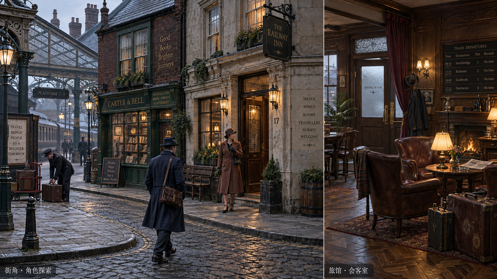

# 古典侦探世界：美术方向修正

日期：2026-10-08。用户明确给出的参考是“东方快车、福尔摩斯、埃勒里”，并指出当前 Blender 建模不符合心目中的侦探世界。

随后用户确认：“接近，按这个方向做 Blender 实机样板。”据此开始有限范围的原创实际建模与本地运行样板。该确认适用于概念气质与写实方向，不等同于已认可尚未制作的 Blender 成品。

首版实际产物现已保存：[铁路旅馆 Blender 与浏览器样板](../../3d-town/classic-railway-v1/README.zh-CN.md)，本机入口为 <http://127.0.0.1:3187/town-play/art-sample>。其中提供真实渲染、源模型、运行画面及检查记录，仍保留最终艺术验收未完成的状态。

当前入口已更新为 [车站、旧书店与旅馆](../../3d-town/classic-station-v1/README.zh-CN.md)，配合独立骨骼人物。可在同一段街道连续走进三间室内，附实际游览录像及四个视角的 1080p 短时性能记录；[会客室精修 v2](../../3d-town/classic-railway-v2/README.zh-CN.md) 等早期产物仍保留作对照。

## 当前方向与证据

这张由内置图像生成工具制作，是美术讨论用的原创概念，尚不是 Blender 渲染、游戏画面或性能证明。它的主镜头比正式游戏要求更接近街景视角，人物也更大；后续需要用真正的斜俯视游戏镜头检验同样的建筑和人物。图内生成的招牌、时刻表和道具内容不属于游戏设定或案件真相。

用户此前仅确认了保留 3D、角色探索与工具栏，未确认河湾粉彩微缩风格。新的文学参考取代“河湾微缩镇”作为默认美术假设。已有模型、源文件和证据保留作比较，不继续按旧造型批量扩建。总体开发目标继续有效，调整的是当前美术工作方向。

## 对现有画面的具体判断

本轮实际查看了河湾街区 production.png、街角问候的真实浏览器截图、咖啡馆 Blender 渲染及此前的界面概念图。

1. 咖啡馆、书店和警务所的体块、窗型、百叶和遮阳棚重复，主要靠文字与颜色区分。需要让经营用途和建筑历史改变轮廓、开口与入口组织。
2. 实机截图中铺地占据大部分画面，人物偏小，生活与调查空间的层次被削弱。需要更紧凑的街角和有前中后景的可行走街巷。
3. 人物、树冠和部分道具的原始几何感明显，与用户给出的成熟古典推理气质不符。需要成人比例、服装结构与更可信的植物轮廓。
4. 材料主要依赖平涂色块，缺少石、砖、木、皮革与黄铜之间的尺度和粗糙度差异；咖啡馆顶角被裁切、整体偏暗，也还不是合格的最终构图。
5. 以前生成的概念图比实际模型有更多材料和生活细节。这种差距必须用同一处真实模型、同一游戏镜头的对照缩小，不能反复用更漂亮的生成图替代建模质量。

## 原创美术转译

暂用一座约 1928—1934 年的原创铁路小城作为统一样板：保留更早的维多利亚/爱德华时期建筑，室内适度采用两战之间的陈设。具体国家、精确年份和写实程度仍是设计候选，不将三个作家的所有年代与地理符号机械混搭。

| 用户参考 | 拟提取的美术与空间特征 | 对场景的要求 |
| --- | --- | --- |
| 东方快车 | 木饰、黄铜、皮革行李、旅行者与封闭空间 | 旅馆会客室与车站有联系；门、通道、座位和视线真实成立 |
| 福尔摩斯 | 老街、砖石立面、窄门楼梯、书房与生活陈设 | 建筑尺度成熟；街道有历史累积，房间有主人的职业和使用痕迹 |
| 埃勒里 | 清楚可推理的空间关系和人物社会身份 | 窗口视野、物品位置、进出路径能承载线索，装饰不妨碍观察 |

上述是针对用户参考的原创设计解释，不声称还原某部影视作品的布景、服装或某一本小说。角色、店铺、地图、案件与界面均自行设计。

[阿加莎官方资料](https://www.agathachristie.com/en/film-and-tv/murder-on-the-orient-express/facts-about-murder-on-the-orient-express)记载《东方快车谋杀案》1934 年出版，并提到作者核对车厢布局及门把手等位置；[福尔摩斯博物馆说明](https://www.sherlock-holmes.co.uk/about-the-museum/)明确其维多利亚时期环境。采用两战之间小城、保留旧建筑是本项目的设计选择，不是把福尔摩斯的原作年代改写为 1930 年代。

## 第一个真实 Blender 样板

范围收敛到铁路旅馆入口、一侧书店立面、连通的会客室和一个成人比例人物研究。不要在证明风格前复制整座城。

- 建筑：独立设计门框、窗套、檐口、基座、屋顶接缝与排水构件；用真实深度和有功能的细节塑造层次。
- 材质：砖石、深木、旧黄铜、布料、皮革形成清楚差异；磨损集中在经常接触和受雨的部位。
- 人物：先验证成人头身比、肩线、衣领、袖口和鞋；服装与职业可辨。最终角色动画与绑定单独验收。
- 光照：阴天或柔和日光也能读清入口和人物，室内暖灯形成局部焦点。悬疑感由空间和叙事建立，不能靠整体压黑掩盖细节。
- 镜头：同时提供斜俯视探索、近距离调查、全镇俯瞰局部及室内行走视角，先确保玩家真的能看见这些美术。
- 推理空间：门窗与实际开口一致，位置关系可解释“谁能看见谁”；叙事摆件不直接泄露未发现的案件信息。

顺序保持用户原定流程：Blender 构图灯光→多视角渲染→Function 动线→Form 材质比例→浏览器与 Windows 运行。原生 Unity/Godot 迁移不在当前路线内。

## 验收边界

用户的文学参考与本张概念的方向已确认；精确年代/地区、最终 Blender 美术与游戏镜头仍待实际产出后的审美判断。角色探索/工具栏和 Agent 社会模拟保持原定目标。生成图的摄影感与细节密度不能视为当前 Web 实现已达到的效果或保证。
