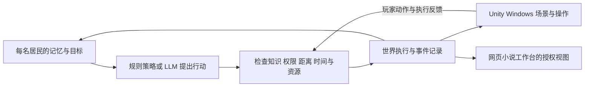

# 保留 Agent 侦探小镇：开源机制参考与原生客户端边界

日期：2026-10-08。状态：研究与建议，尚未进行 Unity/Godot 迁移，也未引入上游代码、素材、依赖或模型服务。

## 已确认的产品方向

- Windows 下载版游戏；网页保留小说工作台。
- Blender 原创 3D 建模、角色探索与工具栏操作，同时保留观察全镇人物和案件的能力。
- Agent 社会模拟是核心产品能力：人物拥有各自的目标、知识、记忆和关系，在玩家没有逐个下指令时也能行动。
- Unity＋URP 是此前提出的客户端建议，尚未通过原生样片验证；更换渲染引擎不改变模拟核心的归属。
- 原有美术顺序继续适用：Blender 构图与灯光、多视角渲染、Function、Form、目标设备运行验收。原生候选补充 Windows 实机验证，网页小说工作台继续做浏览器验证。

## 研究范围与证据边界

通过 Exa 的两个检索方向检查了 12 条搜索结果，筛出三个直接相关的原始项目/论文，再读取原始仓库架构、许可和部分代码。不是 12 个独立项目；结果包含同一仓库的 README、翻译和分支。

本轮未安装、运行或压测这些上游项目。因此，下面的已核实内容限于文档、许可和所列源代码；README 的产品宣传不能视为真实长时间运行、推理质量或商业成熟度证明。

本地检查基于当前脏工作区，Git HEAD 为 `224955696d0af85c80684218dbaeddeaf3808a36`，不是该提交的干净发布版本。本轮仅新增本研究文件。

## 三个参考项目各取什么

### 1. Cultivation World Simulator：规则与自主计划结合

[原始仓库](https://github.com/4thfever/cultivation-world-simulator)。本轮源码检查固定于 `471fe745e7c3d582048d647257c74ae566cd235f`。

实际读取的代码显示：LLM 决策输入包含角色信息、角色可观察对象、世界信息与动作描述，输出动作序列和短期目标；已有动作/计划的角色不会在该决策阶段重新生成整条计划。动作有独立的运行状态与生命周期，模拟阶段分别处理感知、目标思考、计划提交、行动执行和关系演变。

直接依据：[AI 决策](https://github.com/4thfever/cultivation-world-simulator/blob/471fe745e7c3d582048d647257c74ae566cd235f/src/classes/ai.py)、[动作阶段](https://github.com/4thfever/cultivation-world-simulator/blob/471fe745e7c3d582048d647257c74ae566cd235f/src/sim/simulator_engine/phases/actions.py)、[动作运行状态](https://github.com/4thfever/cultivation-world-simulator/blob/471fe745e7c3d582048d647257c74ae566cd235f/src/classes/action_runtime.py)、[阶段注册](https://github.com/4thfever/cultivation-world-simulator/blob/471fe745e7c3d582048d647257c74ae566cd235f/src/sim/simulator_engine/phase_registry.py)。

对侦探小镇的转化建议：

| 修仙模拟机制 | 侦探小镇里的原创实现 |
| --- | --- |
| 长短期目标 | 保住工作、偿还债务、维护名誉；今天去送信、见某人或查账 |
| 组织与人物的利益 | 警署、报社、商会、家庭、旅馆的不同目标与权限 |
| 多阶段长动作 | 从约见、赴约、交谈到返程；从申请调档到取档与归还 |
| 关系演化 | 信任、畏惧、亏欠与怀疑影响求助、拒绝、作证和传播消息 |
| 世界事件 | 因营业、物品转移、失约和信息传播产生可追查事件 |

这些是拟议设计，不是已经完成的功能。修仙的数值体系和叙事内容不直接移植到侦探题材。

许可：当前 [LICENSE](https://github.com/4thfever/cultivation-world-simulator/blob/471fe745e7c3d582048d647257c74ae566cd235f/LICENSE) 为 CC BY-NC-SA 4.0，包含非商业和相同方式共享条件。不能把它当作 MIT 商用依赖直接纳入。当前路线是研究机制、独立实现；若未来要复用受许可约束的代码或素材，应按相应条款处理或另行取得授权。素材许可还需单独检查。

### 2. Generative Agents：记忆如何影响下一次行动

[论文](https://arxiv.org/abs/2304.03442)、[原始仓库](https://github.com/joonspk-research/generative_agents)。论文提出经验记忆、结合相关性/时间/重要性的检索、反思和规划，在 25 人小镇中展示社会行为。仓库定位是研究实现，不能直接等同于可发行游戏底座。

拟借鉴记忆结构与目标更新方式。对侦探玩法必须额外区分：亲眼所见、听谁说的、自己的推测、故意表达的谎言。反思可以形成信念，不能把推测升级成真实物证。行动解释只记录简短的决策摘要与证据引用，不依赖展示模型的内部推理过程。

当前代码根许可是 [Apache-2.0](https://github.com/joonspk-research/generative_agents/blob/main/LICENSE)。具体资产与附属内容不因根许可证而自动全部通过复用审查。

### 3. AI Town：让异步 Agent 接入持续世界

[原始仓库](https://github.com/a16z-infra/ai-town)、[架构说明](https://github.com/a16z-infra/ai-town/blob/main/ARCHITECTURE.md)。架构将 Agent 的异步模型操作与核心游戏状态更新分离，外部操作通过输入提交，由世界引擎处理；客户端负责显示状态。记忆层还包含对话摘要、检索和缓存。

拟借鉴单一世界状态写入入口、异步任务、输入回执和显示插值。无需为此把现有 SQLite/TypeScript 系统整体换成 Convex。它的社交机制也不能直接保证侦探案件可解。

当前代码根许可是 [MIT](https://github.com/a16z-infra/ai-town/blob/main/LICENSE)。本轮未复制其源码或像素素材。

## 现有项目已经有什么

本地源码可见：

- `packages/engine/src/persistent-town.ts`：NPC 目标、计划、已知事实、关系压力、资源、疲劳与警觉；基于规则的行动候选评分；决策与事件关联记录。
- `packages/engine/src/town/runtime.ts`：感知、记忆传播、目标更新、动作评分、长动作推进、关系后果、案件候选与验证等阶段。
- `packages/engine/src/town/agent-control.ts`：外部 Agent 查询/提案/提交契约和来源引用约束。声明存在不等于所有路径都在本轮重新验证。
- `packages/engine/src/town/daily-routine.ts`：按日程沿道路推进、持续保存旅程状态的实现。
- `packages/engine/src/town-exploration.ts`：当前探索入口会推进原有 Persistent Town，展示玩家当前观察到或曾经见过的居民。
- `lib/world/ai.ts`：限制 NPC 可见信息的对话提示构建和审查逻辑；存在模型适配代码不等于当前 3D 场景已经启用全员实时 LLM 决策。
- `docs/scenario-pack-review-bundle.md` 已记载对修仙模拟器分阶段模拟模式的早期参考。

因此，应继续扩展现有规则与模拟核心。当前 3D 河湾入口中的局部走动、问候和固定首案，不能代表旧引擎所有能力已经完整表现出来；同样不能把字段或阶段名称当作已经完成自由自主社会模拟的证据。

## 建议的系统边界

世界核心先保留 TypeScript，拟拆出供游戏启动的本地服务。Unity/Godot 不直接修改真相、记忆或物品归属；移动、对话、交易等有后果的动作仍经统一规则入口。作者工作台与玩家客户端采用不同的知识视图。具体本地通信、会话、进程生命周期和存档升级需要另外实现。

每个居民可以拥有独立状态与记忆，但可以共享一个模型服务。独立 Agent 不要求每人运行一个独立大模型进程。

### 时间和动作

- 画面逐帧更新；世界按明确的游戏时钟推进；模型只在需要重新决策、重要交互或目标变化时调用。
- 日程是默认计划。紧急事件、承诺和玩家互动通过统一的优先级机制调整计划，避免日程和自主计划两套系统互相覆盖。
- 行动区分计划、前往、到达、执行、完成、失败与中断。到达前不能完成取物或现场作证，动画播放完毕也不能独立生成第二次世界后果。
- 模型任务异步处理，并发数、上下文长度、每段游戏时间的请求预算都设上限。返回时重新核对世界版本和动作条件；过期计划不能直接执行。
- 模型不可用时采用明确标记的规则策略维持日常活动，不能把这种降级结果宣称为实时 LLM 自主决策。
- 原生版暂停、加速和离线经过时间的规则必须显式定义；不默认用户关掉游戏后仍无限调用模型推进世界。

### 回放与可验证性

LLM 新生成的计划不保证相同种子下完全一致。可复现目标是：记录已经接受的模型提案、随机抽样结果和玩家输入，重新执行这些记录时还原相同的权威事件与状态。不能用重新请求一次模型来冒充确定性回放。

## 侦探题材需要额外守住的能力

1. 世界事实、人物信念、人物陈述、玩家已知信息分别保存。人物可能误会或撒谎，系统仍保有对应事实与信息来源。
2. 模型可以提出隐藏某件物品的意图；物品是否存在、能否接触、是否被看见、花费多久，由规则结算。
3. 案件候选应来自已发生的事件及其因果和证据记录。玩家进入调查后，既有事实不能因为模型生成了更戏剧化的结局而被改写。
4. 后续掩盖行为以新事件追加。若玩法允许证据损毁，要提前设计替代线索或明确失败条件，避免无提示地把案件变成不可解。
5. 世界可以发生没有足够证据的普通事件；只有通过证据覆盖、时空一致性与调查路径验证的候选，才能作为正式可解案件交给玩家。
6. 小说工坊从指定世界分支和版本取材。文学润色与创作性改稿不直接改写玩家存档；需要改设定时另开可追踪分支。

一个拟议样例：居民急需偿还债务，决定寻找某份档案；实际前往档案所在地点；另一居民在合法视听范围内看到片段；该目击进入个人记忆并可能被转述；物品移动和时间记录构成调查材料；玩家可追踪，而作者工作台在授权视图中组织成小说。事件是否发生由运行时决定，不预先承诺每次都产生同一剧情。

## 调整后的实施顺序

| 阶段 | 具体产物 | 完成条件 |
| --- | --- | --- |
| 1. 核对和连接已有模拟能力 | 12 人状态、日程与即时目标的统一调度；有界动作清单；来源可追踪的知识 | 行为不依赖玩家逐个触发；合法动作产生一次后果；非法动作被拒绝 |
| 2. 小范围实时 Agent | 先选 3 名居民启用事件触发的真实模型计划，其他居民保留规则策略 | 提案会改变实际行动；未知事实不进入上下文；超时、过期返回和预算耗尽可恢复 |
| 3. 原生表现样片 | 一条街、咖啡馆、模型计划驱动的赴约/交互/取物，玩家可介入 | 同一件事在画面、权威日志、居民记忆与存档中一致；不是仅播放行走动画 |
| 4. 调查候选 | 从真实事件组合一件小型非致命案件，保留现有固定首案作回归基线 | 物证与证词有来源、时间线一致、调查路径可达、既有真相不会被改写 |
| 5. 群体与小说 | 将经过验证的能力扩展到 12 人；加入组织目标；导出一个版本固定的故事包 | 跨场景互动可追踪；记忆与代价有界；章节不混用不同世界分支 |

允许继续原有 Blender 美术工作，但客户端迁移是否正式成为主线，必须同时看 Agent 行动闭环与实机画面。上述阶段是建议，尚未据此启动模型调用或迁移代码。

## 首批验收建议

- 在多个随机种子和初始状态下推进至少 7 个游戏日，保存连续运行和恢复运行的对照；这是首轮工程门槛，不是长期社会真实性证明。
- 针对越权知识、过期计划、重复回执、越界移动和物品不存在设置负向案例，逐项确认不会提交非法世界事件。
- 记录实际行动变化、可观察交互和后果；不能只以对话数量、文字长度或“思考”面板判断 Agent 成功。
- 同一已接受输入记录的回放结果一致；重新调用 LLM 的新实验单独统计。
- 真实模型延迟与 token 用量、无模型降级比例、拒绝/重规划率均保留，先测量再设产品预算。
- 1080p/60fps 是原生样片的性能目标，尚无测量结论；模型调用不应阻塞画面更新，持续测试需同时覆盖存档和模拟负载。
- 案件可解性的自动检查与真人对趣味、理解度和美术的判断分开记录；不会以自动通过代替后者。

## 明确不纳入本轮的动作

本轮没有下载/安装引擎、复制上游代码或素材、部署服务、使用用户模型密钥、运行付费模型请求，也没有把上游 README 或本研究建议标记成已实现能力。旧工作区和已有案件保持原状。

## 后续选型澄清：网页技术也能交付 Windows 游戏

2026-10-08，用户继续询问这些参考项目为何采用网页，并明确表示仍在犹豫。Unity 主线是建议，尚未成为用户确认的迁移决定。

进一步读取修仙模拟器的 [desktop/package.json](https://github.com/4thfever/cultivation-world-simulator/blob/main/desktop/package.json) 与 [electron-builder.config.cjs](https://github.com/4thfever/cultivation-world-simulator/blob/main/desktop/electron-builder.config.cjs)，确认其仓库包含 Electron 桌面壳、Windows x64 打包目标和随包携带后端的配置。这里只确认源码配置，未亲自运行其发行包。Windows 下载版是交付方式，Unity/Godot 是客户端开发工具，二者不能等同。

作者明确公开的定位：AI Town README 表述了可扩展的模拟开发底座及提供 JS/TS 框架的目标；Generative Agents 仓库是论文配套模拟和回放实现；修仙模拟器采用 Python/FastAPI＋Vue/PixiJS，并已有桌面打包配置。本轮未找到三者作者共同或明确针对“为何不用 Unity”的比较结论。

基于这些架构的工程推断：重点在记忆、计划、关系、模型调用与世界规则的项目，可以通过 Web 前端较直接地展示和调试后端状态；当视觉需求主要是地图、人物标记、对话和信息界面时，迁移 3D 引擎的收益未必覆盖成本。这是本报告的分析，不是替作者陈述动机。

当前项目还存在第三条可行路线：Blender＋Three.js 3D＋独立 Agent 模拟核心＋Windows 桌面封装，小说工作台继续复用 Web 技术。[Electron 官方说明](https://www.electronjs.org/docs/latest/)确认它通过 Chromium 和 Node.js 支持使用 Web 技术开发桌面应用。封装不会自动提高 3D 帧率，也不会免除本地进程、存档、更新和模型配置的工程工作。

修正建议：现阶段先继续现有技术中的 Agent 行动、事件后果与调查闭环，并完善已有 Blender 资产；不以“Windows 下载版”或“顶级”作为必须迁移 Unity 的理由。只有在同一段目标内容的实测中，确认角色动画、灯光制作、场景工作流或运行性能确实需要引擎提供的收益，再决定是否迁移客户端。避免同时长期维护两套完整游戏。模拟核心继续与表现层分离，因此这些工作不会绑定最终客户端选择。
